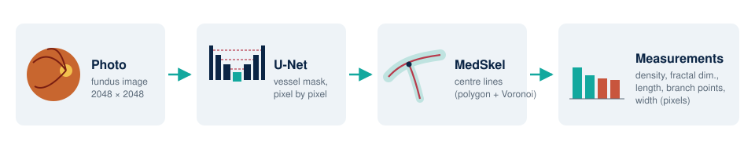
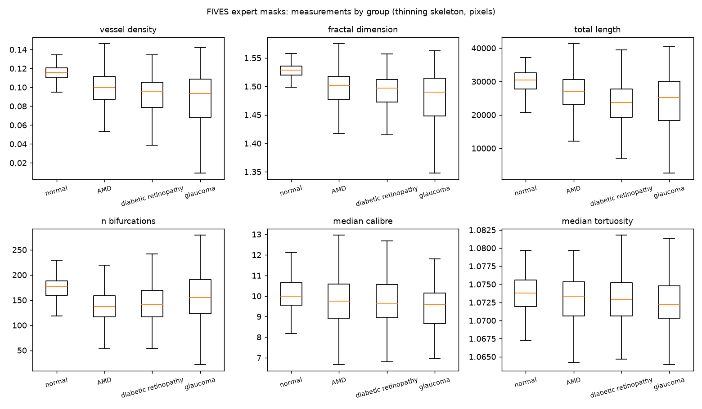

# MedSkel AI

[](https://github.com/MouhssineElBoumshouli/medskel-ai/actions/workflows/tests.yml)


**Retinal vessel segmentation with a U-Net written from scratch, then geometric measurement of the vessels.**

A photo of the back of the eye goes in. A U-Net marks every vessel pixel. MedSkel, a geometric skeleton method, traces each vessel's centre line. Six measurements come out and are compared with healthy and diseased eyes.

<p align="center"></p>

Built for the course *Neural Networks and Deep Learning* (EIDIA, Euromed University of Fes, Prof. N. Joudar). Research prototype: not a medical device, no diagnosis.

## Results at a glance

| | |
| --- | --- |
| **0.889** | mean Dice on the 200 official FIVES test images (95% interval 0.873 – 0.903) |
| **0.766** | Dice on CHASE_DB1, another camera, never used for training; two human experts agree at 0.777 |
| **2×** | more stable branch-point counts with MedSkel centre lines than with standard thinning (26% vs 53% change) |
| **7.8 M** | parameters, all trained from scratch in 150 minutes on a 4 GB laptop GPU |

<details>
<summary><b>Full segmentation table</b></summary>

Plain U-Net, 7,849,601 parameters, trained on 510 FIVES training images (random 512 × 512 crops at full resolution). Predictions averaged over 4 mirrored passes. Threshold 0.30, chosen on 88 validation images. Brackets: 95% bootstrap interval.

| Test | Dice | clDice | Sensitivity | Specificity |
| --- | --- | --- | --- | --- |
| FIVES official test set, 200 images | **0.889** (0.873 – 0.903) | 0.897 | 0.874 | 0.994 |
| CHASE_DB1 (external, 28 images, 14 children) vs observer 1 | 0.766 (0.750 – 0.782) | 0.835 | 0.908 | 0.949 |
| Human observer 2 vs observer 1 on CHASE_DB1 | 0.777 (0.766 – 0.788) | 0.835 | 0.769 | 0.978 |

Per disease group on FIVES: AMD 0.917 · diabetic retinopathy 0.888 · glaucoma 0.850 · healthy 0.902.
Version 1 (50 minutes of training): 0.875. A reference U-Net with an ImageNet-pretrained ResNet34 encoder: 0.907 on FIVES, 0.770 on CHASE_DB1.
</details>

<details>
<summary><b>Measurements and disease groups</b></summary>

- Set-up check: the human-vs-human length differences on CHASE_DB1 reproduce the original `medskel` result exactly (9.3% thinning, 3.2% MedSkel).
- FIVES test, CNN mask instead of expert mask: branch points change 26% with MedSkel vs 53% with thinning; width 13% vs 18% (p < 0.001).
- AMD, diabetic retinopathy and glaucoma eyes have lower vessel density, fractal dimension, length and branch counts than healthy eyes (p < 0.001).
- But six measurements guess the group of one eye only 45–49% of the time (chance: 25%). A group-level signal, not a diagnosis.

<p align="center"></p>
</details>

**Known limits:** about half of the thinnest vessel pixels (1–4 px wide) are missed; the model over-marks on a new camera; measurements are in pixels, not millimetres; FIVES publishes no patient ids; one training run per setting.

## How it works

| Step | What happens | Code |
| --- | --- | --- |
| Data | Pair each photo with its expert mask by file name, split 510 / 88 / 200, cut 512 × 512 crops at full resolution | [`data.py`](src/medskel_ai/data.py) |
| Model | U-Net: 4 encoder blocks (32 → 256 channels), bottleneck (512), 4 decoder blocks with skip connections, 1 logit per pixel | [`model.py`](src/medskel_ai/model.py) |
| Training | Loss = binary cross-entropy + soft Dice, Adam, cosine learning rate, mixed precision, fixed seed 42 | [`train.py`](src/medskel_ai/train.py) |
| Prediction | Overlapping 512 × 512 tiles stitched back together, optional 4 mirrored passes | [`predict.py`](src/medskel_ai/predict.py) |
| Evaluation | Dice, IoU, clDice, thin-vessel recall, bootstrap intervals; threshold chosen on validation; the test command refuses to run twice | [`evaluate.py`](src/medskel_ai/evaluate.py), [`topology.py`](src/medskel_ai/topology.py), [`chase.py`](src/medskel_ai/chase.py) |
| Measurement | Thinning vs MedSkel centre lines; density, fractal dimension, length, branch points, width, tortuosity | [`morphometry.py`](src/medskel_ai/morphometry.py), [`study.py`](src/medskel_ai/study.py) |
| App | Upload a photo: vessels, centre lines, measurement table and chart in about 6 seconds | [`app.py`](app.py) |

The full explanation, from "what is a pixel" to every file of the code, is in the **[study guide (PDF)](docs/guide/medskel_guide.pdf)**. The class report source is in [`docs/report/`](docs/report/) (French and English).

## Run it

Windows, PowerShell, Python 3.11, an NVIDIA GPU for training (the app also runs on CPU).

```powershell
py -3.11 -m venv .venv
.\.venv\Scripts\python.exe -m pip install torch --index-url https://download.pytorch.org/whl/cu126
.\.venv\Scripts\python.exe -m pip install -e ".[dev,demo,morphometry]"

# the measurement step imports the original MedSkel code, read-only, from a folder next to this one
git clone https://github.com/MouhssineElBoumshouli/medskel ..\medskel
git -C ..\medskel checkout 1a838a8

.\.venv\Scripts\python.exe -m pytest        # 55 tests on synthetic data, no dataset needed
```

Put [FIVES](https://doi.org/10.6084/m9.figshare.19688169) **outside the repository**, at `C:\data\FIVES` (or pass `--data <folder>`), with `train\Original`, `train\Ground truth`, `test\Original`, `test\Ground truth`.

| Step | Command |
| --- | --- |
| Model shapes and parameter count | `python -m medskel_ai.model` |
| Check the data, write the split | `python -m medskel_ai.data` |
| Train (150 minutes, RTX 3050 4 GB) | `python -m medskel_ai.train --minutes 150 --out runs/e2_long` |
| Choose the threshold on validation | `python -m medskel_ai.evaluate --run runs/e2_long --split val --flips` |
| Test, once per model | `python -m medskel_ai.evaluate --run runs/e2_long --split test --flips` |
| External test on CHASE_DB1 | `python -m medskel_ai.chase --run runs/e2_long --flips` |
| Segment one photo | `python -m medskel_ai.predict --image photo.png --checkpoint runs/e2_long/best.pt --flips` |
| Measurement study (a few hours, resumable) | `python -m medskel_ai.study all` |
| **App** | double-click **`MedSkel AI.bat`**, or `python app.py` then open http://127.0.0.1:7860 |

(Write `.\.venv\Scripts\python.exe` instead of `python` if the virtual environment is not activated.) Trained weights and run outputs go to `runs/`, which Git ignores; small number-only result files are copied to [`results/`](results/).

## Repository layout

```text
src/medskel_ai/     the code (data, model, training, prediction, evaluation, measurements)
app.py              the local app;  MedSkel AI.bat opens it with a double-click
tests/              automatic tests on synthetic images
results/            numbers behind every claim (JSON / CSV) and figures
docs/guide/         study guide (LaTeX + PDF)
docs/report/        class report source, French and English
docs/               project notes: data protocol, decisions, boundaries, measurements
report.md           short technical report
```

## Data and honesty rules

- No photos, masks, datasets or trained weights are stored in this repository.
- Every decision (threshold, training time, experiments) was made on validation images; the official test set was opened only to report final scores.
- Every number in this README comes from a file in [`results/`](results/).
- Measurements are in pixels. Segmentation quality, measurement stability and clinical usefulness are separate claims; only the first two are tested here.

## Related work and sources

- U-Net: Ronneberger, Fischer and Brox, MICCAI 2015 — https://arxiv.org/abs/1505.04597
- FIVES: Jin et al., *Scientific Data* 2022 — https://doi.org/10.1038/s41597-022-01564-3 (data: https://doi.org/10.6084/m9.figshare.19688169)
- CHASE_DB1: Fraz et al., IEEE TBME 2012; Kingston University — https://researchinnovation.kingston.ac.uk/en/datasets/chasedb1-retinal-vessel-reference-dataset-4/
- clDice: Shit et al., CVPR 2021 — https://arxiv.org/abs/2003.07311
- MedSkel (bisector skeletons): Saidou et al. 2024; original code: https://github.com/MouhssineElBoumshouli/medskel
- Established tools for comparison: AutoMorph, VascX ([notes](docs/06_RESEARCH_AND_COMPETITION.md))

To cite this code, use [`CITATION.cff`](CITATION.cff) (GitHub shows a "Cite this repository" button).

<sub>Working notes for AI coding agents are in [`CLAUDE.md`](CLAUDE.md), [`AGENTS.md`](AGENTS.md) and [`PROGRESS.md`](PROGRESS.md).</sub>
