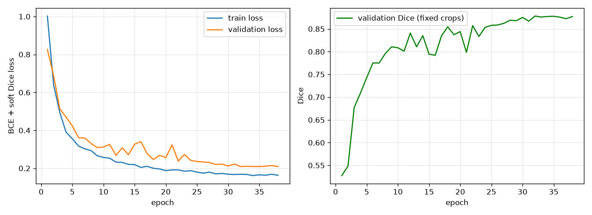

# Retinal vessel segmentation with a small U-Net: training, validation and external testing

**Author:** Mouhssine El Boumshouli — CNN class project — version 2, November 2026

**Code:** `MouhssineElBoumshouli/medskel-ai`. Version 1 = pull request #4 (baseline). Version 2 = branch `feature/v2-validation`.

---

## Abstract

We train a plain U-Net (7.85 million parameters, no pretrained weights) to mark blood vessels in colour photographs of the retina, using the public FIVES dataset (800 photographs, 2048 x 2048 pixels, expert masks). Version 1 of this project reached a mean Dice of 0.875 on the 200 official test images. Version 2 asks two questions: can we improve it, and how far can we trust it?

We first measured the known weakness with two new metrics. On validation images the baseline finds 89% of thick-vessel pixels but only **46% of thin-vessel pixels**. We then tested changes one at a time on validation data only. Training three times longer and averaging predictions over mirrored copies of the image both helped. Adding a clDice term to the loss did not help and was dropped. The final model reaches a mean Dice of **0.889** (95% interval 0.873 to 0.903) on the FIVES test set, clDice 0.897 and thin-vessel recall 0.458. A standard U-Net with an ImageNet-pretrained ResNet34 encoder, trained with the same data and time, is better (Dice 0.907): our from-scratch model is a sound baseline, not the strongest possible model.

On an external dataset from another camera and population (CHASE_DB1, 28 images of 14 children, never used for training or tuning), the final model reaches Dice 0.766 against the first human observer. The second human observer reaches 0.777 against the first. The difference is not statistically clear, but the model and the human make different kinds of errors: the model marks more pixels as vessel.

The FIVES test set has now been used twice: once in version 1, and once in version 2 for the two final models (one evaluation each). The model is a research prototype, not a medical device.

## 1. Introduction

Blood vessels of the retina can be photographed directly. Before anyone can measure a vessel, a program must decide which pixels belong to vessels. This is **binary segmentation**: one yes/no answer per pixel. Vessels are thin, low in contrast, and rare (7.5% of the pixels in our training masks).

The project has two goals. The educational goal: build the smallest U-Net that is still a real model and understand every step (see `docs/explanation.md`). The engineering goal of version 2: improve the model with controlled experiments, and measure honestly where it works and where it does not, including on data from elsewhere.

## 2. Data

### 2.1 FIVES (training, validation, test)

FIVES (Jin et al., 2022) contains 800 colour fundus photographs with pixel-level vessel masks: 200 each for AMD (A), diabetic retinopathy (D), glaucoma (G) and normal (N). The paper describes a tabletop TRC-NW8 camera with a 50° field of view and images of 2048 x 2048 pixels from 573 patients. The authors define 600 training and 200 test images.

Our audit of the local copy (`python -m medskel_ai.data`, `results/data_audit.json`):

| Check | Result |
|---|---|
| Image/mask pairs with identical names | 600 train, 200 test; 150 / 50 per group |
| Image size | all 2048 x 2048, masks the same size |
| Mask values | only 0 and 255 in all 800 masks |
| Vessel share of pixels (train) | mean 7.5% (A 7.3%, D 6.9%, G 6.7%, N 9.0%) |
| Completely black masks | 2 in train (`447_G`, `448_G`), 0 in test |
| Byte-identical photographs | 6 pairs: 5 inside train, 1 inside test, 0 between train and test |

The two empty masks are label errors and are excluded. Identical photographs are kept in the same part of the split. From the 598 usable training images, 88 form the validation set (22 per group, seed 42) and 510 are used for training (`results/split_seed42.json`). The same split is used in every experiment.

**Limit.** The 800 images come from 573 patients and no patient identifiers are published. Different photographs of one patient can be in different parts. Scores on FIVES are scores on unseen *images*, not proven scores on unseen *patients*.

### 2.2 CHASE_DB1 (external test only)

CHASE_DB1 (Kingston University; Fraz et al., 2012) contains 28 photographs: both eyes of 14 children, taken with a hand-held Nidek NM-200-D camera at a 30° field of view. Our copy has images of 999 x 960 pixels. Every image has **two** vessel masks drawn independently by two human observers. Licence: CC BY 4.0. We checked: 28 images, 56 masks, masks binary, sizes equal.

No CHASE image was used for training, for choosing a model, or for choosing a threshold.

## 3. Method

### 3.1 Model

A standard U-Net (Ronneberger et al., 2015) in plain PyTorch (`src/medskel_ai/model.py`). Encoder: four blocks with 32, 64, 128, 256 channels, each two 3 x 3 convolutions with batch normalisation and ReLU, followed by 2 x 2 max pooling. Bottleneck: 512 channels. Decoder: four steps of bilinear upsampling, concatenation with the encoder feature map of the same size (skip connection), and a block. A 1 x 1 convolution gives one logit per pixel. **7,849,601** trainable parameters. No pretrained weights.

### 3.2 Training

Images are not resized. Each step uses 4 random 512 x 512 crops (2 photographs x 2 crops) with random flips, 90° rotations and small brightness/contrast changes. Loss: binary cross-entropy on logits plus soft Dice loss, equal weights. Adam, learning rate 0.001 lowered to 0 along a cosine curve over a fixed time budget. Mixed precision. Seed 42. Hardware: NVIDIA RTX 3050 Laptop GPU, 4 GB. After each epoch, Dice on fixed validation crops selects the best weights.

### 3.3 Prediction

A whole image is cut into 512 x 512 tiles overlapping by 64 pixels; tile probabilities are averaged where they overlap. **Flips** (test-time augmentation): the image is predicted four times (original, mirrored left-right, mirrored up-down, both), each result is mirrored back, and the four probability maps are averaged.

### 3.4 Metrics

Per image, then averaged over images:

- **Dice, IoU, precision, recall (sensitivity), specificity, accuracy** from the pixel counts TP, FP, FN, TN.
- **clDice** (Shit et al., 2021) measures connectivity. Both masks are reduced to their skeleton (1-pixel centre lines, `skimage.morphology.skeletonize`). Tprec = share of the predicted skeleton inside the expert mask. Tsens = share of the expert skeleton inside the predicted mask. clDice = 2·Tprec·Tsens / (Tprec + Tsens). On skeletons, a thin vessel counts as much per unit length as a thick one, and a broken vessel lowers Tsens.
- **Thin-vessel recall.** Definition fixed before looking at results: take the skeleton of the expert mask; the distance transform gives at each skeleton pixel the distance d to the background; local width ≈ 2d − 1; every expert vessel pixel gets the width of its nearest skeleton pixel; a pixel is *thin* if that width is ≤ 3 px. Because the formula rounds even widths down, "thin" covers vessels 1 to 4 pixels wide. Thin-vessel recall is the share of thin expert pixels that the model found. On FIVES, thin pixels are only about 1.7% of all vessel pixels.

**Error bars.** For every mean we give a 95% bootstrap interval: we redraw the images with replacement 10,000 times and take the middle 95% of the resulting means. For CHASE we redraw *children*, not images, because the two eyes of a child are not independent. For comparisons between two models on the same images we bootstrap the per-image *difference*.

All FIVES metrics use every pixel of the image. CHASE metrics use the pixels inside the field of view (section 4.6).

### 3.5 Protocol

1. Every decision (which change to keep, which threshold) is made on the 88 validation images.
2. One change at a time, same seed, same data split.
3. The FIVES test set is evaluated once for each of the two final models (our plain U-Net and the pretrained reference), after all choices were fixed. **The test set was already used once for version 1, so it has now been used twice** (two rounds, three model evaluations in total). The version 1 result is kept below unchanged. We did not re-evaluate the version 1 model on the test set with the new metrics.
4. CHASE_DB1 is evaluated with the model and threshold fixed on FIVES.

## 4. Results

### 4.1 Baseline (version 1, pull request #4)

Trained 51 minutes (38 epochs). Threshold 0.40 chosen on validation. FIVES test, 200 images, evaluated once:

| Dice | IoU | Precision | Recall | Specificity | Accuracy |
|---|---|---|---|---|---|
| 0.875 ± 0.114 (std) | 0.791 | 0.909 | 0.856 | 0.993 | 0.986 |

95% bootstrap interval for the mean Dice: 0.858 to 0.890. Median 0.907. By group: A 0.908, D 0.876, G 0.828, N 0.887. An all-black prediction has accuracy 0.929 and Dice 0, which is why accuracy is not a useful score for this task.



### 4.2 Measuring the weakness (baseline, validation)

| Metric (88 validation images) | Value | 95% interval |
|---|---|---|
| Dice | 0.899 | 0.874 – 0.917 |
| clDice | 0.905 | 0.879 – 0.925 |
| Recall on thick-vessel pixels | 0.895 | |
| **Recall on thin-vessel pixels** | **0.459** | 0.422 – 0.497 |

The model misses more than half of the thin-vessel pixels. Dice does not show this, because thin pixels are only 1.7% of all vessel pixels. This is the main weakness, and it is the reason for the two new metrics.

### 4.3 Experiments (validation only)

**Table 1. Validation results, 88 images. "Change" = mean per-image difference to the baseline with its 95% bootstrap interval.**

| Experiment | Threshold | Dice | clDice | Thin recall | Change in Dice | Change in thin recall | Kept? |
|---|---|---|---|---|---|---|---|
| Baseline (50 min) | 0.40 | 0.8985 | 0.9048 | 0.459 | – | – | – |
| E1: baseline + flips | 0.35 | 0.9017 | 0.9091 | 0.480 | +0.003 (0.002 to 0.004) | +0.021 (0.017 to 0.025) | yes |
| E2: 150 min training | 0.25 | 0.9072 | 0.9126 | 0.487 | +0.009 (0.007 to 0.011) | +0.028 (0.021 to 0.034) | yes |
| E3: + soft clDice loss, 50 min | 0.35 | 0.8901 | 0.8986 | 0.438 | −0.008 (−0.010 to −0.007) | −0.022 (−0.029 to −0.014) | **no** |
| E4: E2 + flips (final) | 0.30 | 0.9100 | 0.9154 | 0.484 | +0.011 (0.009 to 0.014) | +0.025 (0.018 to 0.032) | final |

- **E1, flips.** A small but consistent gain on all three metrics, with no retraining. Cost: prediction takes four times longer.
- **E2, longer training.** 115 epochs in 151 minutes; best epoch 104. The largest single gain. Training loss 0.146, validation loss 0.203 at the end: the gap grew a little compared with the baseline (0.16 / 0.21) but the validation loss did not rise.
- **E3, soft clDice loss** (weight 0.5 added to BCE + Dice, 10 skeleton iterations, 50 minutes like the baseline). **Worse on all three metrics, including clDice itself.** Two honest remarks: the extra loss makes each step slower, so the run finished 32 epochs instead of 38 in the same time; and we tried one weight only. So we can say "it did not help under our budget", not "clDice loss does not work". We dropped it.
- **E4, combination.** Only E1 and E2 helped, so the combination needs no new training: it is the E2 model predicted with flips. This is our **final plain U-Net**. (Flips slightly lowered thin recall for this model, 0.487 → 0.484, while Dice and clDice rose. We decided by Dice, as fixed in advance.)

All differences come from one training run per setting. We did not measure how much results change between seeds, so small differences (a few thousandths) should not be over-read.

### 4.4 A strong reference: U-Net with a pretrained encoder

To know how good our small model really is, we trained a standard strong baseline: a U-Net whose encoder is a ResNet34 pretrained on ImageNet (library `segmentation_models_pytorch`, 24.4 million parameters). Same data, same split, same loss, same seed, same 150-minute budget (191 epochs, because each epoch is faster). Flips and threshold (0.40) were chosen on validation, as for our model. It is a comparison model only; the model we explain remains the plain U-Net.

**Table 2. Our final plain U-Net against the pretrained baseline. "Difference" = pretrained minus ours, per image, with 95% interval.**

| | Parameters | Val Dice | Val clDice | Val thin recall | Test Dice | Test clDice | Test thin recall |
|---|---|---|---|---|---|---|---|
| Our plain U-Net (E4) | 7.8 M | 0.910 | 0.915 | 0.484 | 0.889 (0.873 – 0.903) | 0.897 | 0.458 |
| Pretrained ResNet34 U-Net | 24.4 M | 0.924 | 0.926 | 0.525 | 0.907 (0.891 – 0.921) | 0.910 | 0.485 |
| Difference on the test set | | | | | +0.018 (0.016 to 0.020) | +0.013 (0.011 to 0.016) | +0.027 (0.015 to 0.040) |

**The pretrained model is better on every metric**, on validation and on the test set, and the intervals of the differences do not contain zero. Its test Dice by group: A 0.934, D 0.910, G 0.867, N 0.918; five images below 0.7. This is the expected result: the pretrained encoder starts with useful filters from 1.2 million images and is three times larger.

Two things it does **not** change: thin-vessel recall stays below 50% (0.485), and the same dark photographs fail (worst image Dice 0.02). So the thin-vessel weakness is not specific to our small model.

### 4.5 Final FIVES test (200 images, evaluated once for the final model)

**Table 3. Final plain U-Net (E4), threshold 0.30 with flips. Mean over images with 95% bootstrap interval.**

| Metric | All (200) | A – AMD | D – DR | G – glaucoma | N – normal |
|---|---|---|---|---|---|
| Dice | **0.889** (0.873 – 0.903) | 0.917 | 0.889 | 0.850 | 0.902 |
| clDice | 0.897 (0.881 – 0.911) | 0.921 | 0.895 | 0.851 | 0.921 |
| Thin-vessel recall | 0.458 (0.433 – 0.482) | 0.455 | 0.389 | 0.461 | 0.525 |
| Precision | 0.919 (0.910 – 0.927) | 0.934 | 0.935 | 0.916 | 0.891 |
| Recall | 0.874 (0.854 – 0.892) | 0.906 | 0.854 | 0.820 | 0.917 |
| IoU | 0.813 (0.794 – 0.830) | | | | |
| Specificity | 0.994 | | | | |
| Accuracy | 0.987 | | | | |

Median Dice 0.914. Seven images have Dice below 0.7 (ten for the baseline). Recall on thick-vessel pixels: 0.881.

Compared with version 1 on the same 200 images, the mean per-image Dice rose by **0.015** (95% interval 0.012 to 0.017). The gain is real but modest. The glaucoma group stays the weakest, with a wide interval (0.792 – 0.893). **Thin-vessel recall on the test set is 0.46: the main weakness is still there.** Longer training and flips improved everything a little; they did not solve the thin-vessel problem.

### 4.6 External test on CHASE_DB1, and comparison with a human

Three choices were fixed before any CHASE result was seen:

1. **Scale.** The network learned vessel widths in pixels on FIVES. We measured the retina disc: about 2009 px wide in FIVES (median of 24 training images) for a nominal 50°, and 893 – 923 px in CHASE for a nominal 30°. To give both the same pixels per degree, each CHASE image is enlarged by a factor of about 1.31, predicted, and the *probability map* is resized back to the original size before thresholding. This "matched" setting is the main result. The "native" setting (no resizing) is reported too. The angles are nominal camera values, so the match is approximate.
2. **Field of view.** CHASE has no official field-of-view mask. We build one by thresholding brightness (largest bright region, holes filled; 65 – 70% of the image) and count only pixels inside it.
3. **Threshold.** The one chosen on FIVES validation (0.30 with flips). No tuning on CHASE.

**Table 4. CHASE_DB1, 28 images of 14 children. Mean with 95% interval (children resampled).**

| Comparison | Dice | clDice | Sensitivity | Specificity |
|---|---|---|---|---|
| Final model vs observer 1 (matched scale) | 0.766 (0.750 – 0.782) | 0.835 (0.825 – 0.845) | 0.908 (0.899 – 0.917) | 0.949 (0.945 – 0.953) |
| Final model vs observer 2 (matched scale) | 0.745 (0.729 – 0.760) | 0.871 (0.865 – 0.878) | 0.904 (0.892 – 0.915) | 0.945 (0.939 – 0.950) |
| Final model vs observer 1 (native scale) | 0.748 (0.734 – 0.763) | 0.807 (0.795 – 0.819) | 0.887 (0.877 – 0.898) | 0.947 (0.942 – 0.951) |
| Baseline v1 vs observer 1 (matched scale) | 0.768 (0.752 – 0.783) | 0.830 (0.820 – 0.839) | 0.894 (0.884 – 0.904) | 0.952 (0.949 – 0.956) |
| **Human: observer 2 vs observer 1** | 0.777 (0.766 – 0.788) | 0.835 (0.822 – 0.847) | 0.769 (0.731 – 0.807) | 0.978 (0.974 – 0.982) |
| Pretrained ResNet34 U-Net vs observer 1 (matched scale) | 0.770 (0.754 – 0.785) | 0.840 (0.830 – 0.849) | 0.914 (0.906 – 0.922) | 0.949 (0.945 – 0.953) |

How to read this:

- **The model loses a lot outside FIVES.** Dice falls from 0.889 (FIVES test) to 0.766 (CHASE). Part of this is the dataset itself: even two human experts only agree at Dice 0.777 here.
- **Model vs human.** The paired difference (model vs observer 1) − (observer 2 vs observer 1) is −0.012 in Dice (95% interval −0.035 to +0.011) and 0.000 in clDice (−0.012 to +0.012). Both intervals contain zero. With 14 children we cannot show a difference, and we cannot claim the model *equals* a human either: the sample is small.
- **The errors are of a different kind.** The model's sensitivity is much higher than the human's (0.908 vs 0.769, difference +0.139, interval 0.103 to 0.176) and its specificity is lower (0.949 vs 0.978, difference −0.029, interval −0.031 to −0.026). Its precision is 0.66 against 0.80 for the human. So on CHASE the model marks clearly **more** pixels as vessel than observer 1 does. Possible reasons: vessels drawn wider than the experts draw them, or extra false vessels. We did not examine which.
- **Scale matching helped** (Dice 0.766 vs 0.748, clDice 0.835 vs 0.807), as expected. It was the pre-declared main setting.
- **The version 2 improvements did not transfer.** On CHASE the final model and the baseline have the same Dice (0.766 vs 0.768). What we gained on FIVES is specific to FIVES-like images.
- **The pretrained model's advantage also disappears on CHASE** (0.770 vs 0.766). All three models land at the same place, slightly below human agreement in Dice, with the same over-marking. The limit on CHASE seems to be the change of camera and population, not the size of the model.
- Thin-vessel recall is not reported for CHASE: "3 pixels" means something different at this resolution.

### 4.7 The three worst images, looked at by eye

For `train/174_D` (validation), `test/122_G` and `test/123_G` we saved small figures (photo | expert mask | prediction) in `runs/unet_fives/worst_cases/` and looked at them.

| Image | Baseline Dice | Expert vessel pixels | Predicted | What we see |
|---|---|---|---|---|
| `train/174_D` | 0.15 | 8.5% | 8.1% | **The expert mask does not match the photograph.** It shows a different vessel tree. The prediction follows the vessels visible in the photo. This is a label error, not a model failure. |
| `test/122_G` | 0.03 | 0.7% | 0.03% | **Bad photograph.** Very dark and blurred, with a bright haze at the top. The expert could trace only a few vessel segments. The model found almost nothing. |
| `test/123_G` | 0.11 | 1.7% | 0.12% | Same situation: very dark, blurred photograph; the expert traced one main vessel; the model found a few fragments. |

So the two worst test images are low-quality photographs on which the model fails where a human still sees something. The worst validation image is a wrong label; it lowers our validation mean by about 0.008 Dice, for every experiment equally. We left it in so that all experiments use the same validation set.

## 5. Limits

1. **Thin vessels.** Fewer than half of the thin-vessel pixels are found. Any use that needs small vessels (capillary density, fine branching) is not supported.
2. **External performance is clearly lower** (Dice 0.77 on CHASE) and the model over-marks vessels there. One external dataset with 14 children is a small test.
3. **Patient overlap in FIVES is possible** (800 images, 573 patients, no identifiers). FIVES scores may be optimistic.
4. **The FIVES test set has been used twice.** The second round evaluated two pre-selected models once each, but the test set is no longer untouched.
5. **One seed per experiment.** We have error bars over *images*, not over *training runs*.
6. **Labels are imperfect.** Two empty masks, one mismatched mask, six duplicated photographs with different annotations. As we read the FIVES paper, its masks keep only the pixels that two annotators both marked, which tends to make the reference masks conservative.
7. **Bad photographs break the model** (dark, blurred images). There is no quality check that warns the user.
8. **No field-of-view mask on FIVES**; nominal camera angles for the CHASE scale match; thin-vessel definition depends on resolution.
9. **We compare with no published numbers.** Protocols differ between papers (splits, field of view, resolution), and we only quote numbers we computed ourselves.
10. **Segmentation only.** No widths, lengths or branch counts. Nothing here supports a medical statement about a patient. Not a medical device.

## 6. Next step: from mask to measurement

The mask is not the goal. The goal of the wider MedSkel project is to *measure* vessels. The planned chain is:

**photograph → CNN mask (this project) → skeleton / centre lines (the `medskel` geometry project) → vessel length, width and branching in pixels.**

clDice already links the two halves: it scores a mask by what happens to its centre lines. The next experiment is to run both a standard pixel thinning and the `medskel` skeleton on the *same* predicted masks and on the expert masks, and to see how the 46% thin-vessel recall changes the measured vessel length. Until that is done, no claim about measurements can be made.

## Reproducing the results

```powershell
.\.venv\Scripts\python.exe -m pytest                                              # 34 tests, synthetic data
.\.venv\Scripts\python.exe -m medskel_ai.train --minutes 150 --out runs/e2_long   # final model
.\.venv\Scripts\python.exe -m medskel_ai.evaluate --run runs/e2_long --split val --flips
.\.venv\Scripts\python.exe -m medskel_ai.evaluate --run runs/e2_long --split test --flips   # once
.\.venv\Scripts\python.exe -m medskel_ai.chase --run runs/e2_long --flips         # external test
.\.venv\Scripts\python.exe scripts\compare.py unet_fives unet_fives:flips e3_cldice e2_long e2_long:flips
.\.venv\Scripts\python.exe app.py                                                 # demo
```

Numbers are in `results/` (version 1) and `results/v2/` (version 2). GPU training with mixed precision is not bit-for-bit repeatable.

## References

1. O. Ronneberger, P. Fischer, T. Brox. *U-Net: Convolutional Networks for Biomedical Image Segmentation.* MICCAI 2015. https://arxiv.org/abs/1505.04597
2. K. Jin et al. *FIVES: A Fundus Image Dataset for Artificial Intelligence based Vessel Segmentation.* Scientific Data 9, 475 (2022). https://doi.org/10.1038/s41597-022-01564-3
3. M. M. Fraz et al. *An Ensemble Classification-Based Approach Applied to Retinal Blood Vessel Segmentation.* IEEE Trans. Biomedical Engineering 59 (2012). https://doi.org/10.1109/TBME.2012.2205687 — CHASE_DB1 dataset page: https://researchinnovation.kingston.ac.uk/en/datasets/chasedb1-retinal-vessel-reference-dataset-4/
4. S. Shit et al. *clDice – a Novel Topology-Preserving Loss Function for Tubular Structure Segmentation.* CVPR 2021. https://arxiv.org/abs/2003.07311
5. D. P. Kingma, J. Ba. *Adam: A Method for Stochastic Optimization.* ICLR 2015. https://arxiv.org/abs/1412.6980
6. F. Milletari, N. Navab, S.-A. Ahmadi. *V-Net* (Dice loss). 3DV 2016. https://arxiv.org/abs/1606.04797
7. K. He, X. Zhang, S. Ren, J. Sun. *Deep Residual Learning for Image Recognition.* CVPR 2016. https://arxiv.org/abs/1512.03385
8. P. Iakubovskii. *Segmentation Models PyTorch* (software). https://github.com/qubvel-org/segmentation_models.pytorch
